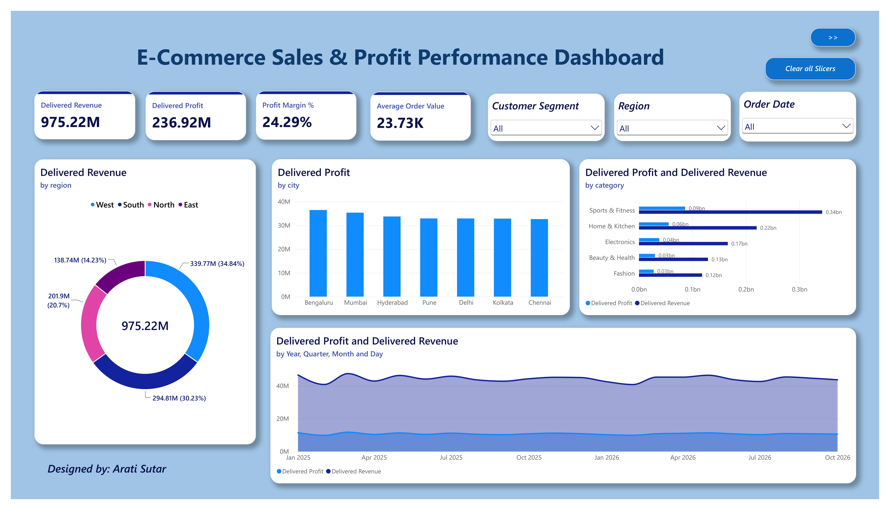
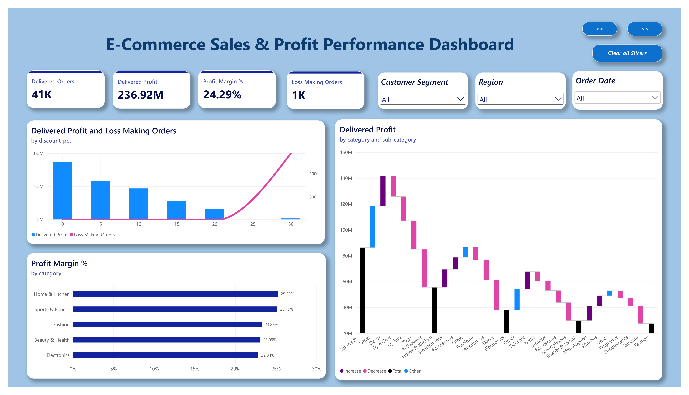
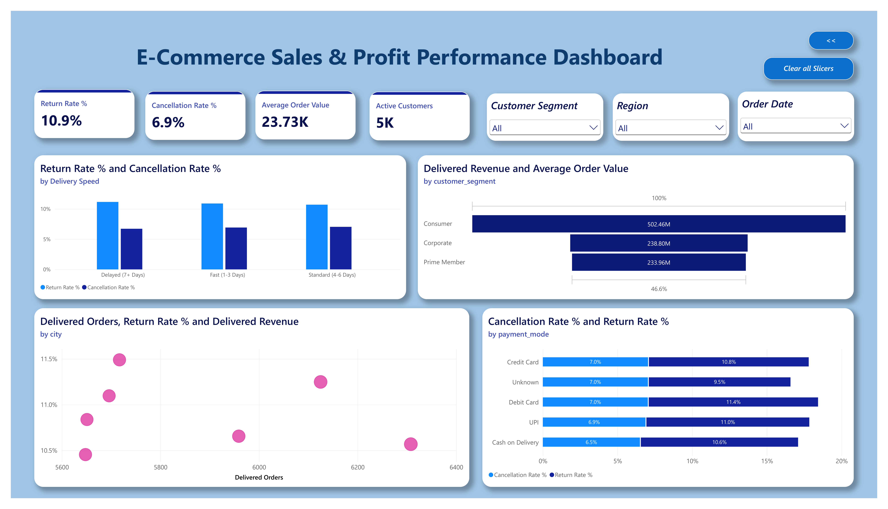

# End-to-End Ecommerce Sales, Profitability & Logistics Analysis

## Project Overview
This project analyzes **50,000+ e-commerce orders** across India to pinpoint profit margin leakage, evaluate promotional discount effectiveness, and identify operational bottlenecks driving order returns and cancellations.

Following a structured data analytics workflow, the project begins with a **Business Requirement Document (BRD)**, handles data cleaning and feature engineering in **Python (pandas)**, answers 10 core business questions using **SQL**, and delivers an interactive **3-page Power BI dashboard** for executive reporting.

---

## Business Objectives
* **Margin & Discount Optimization:** Identify which product sub-categories generate the highest net profit and determine the exact discount threshold where orders turn unprofitable.
* **Logistics & Payment Risk Analysis:** Measure how shipping delays (7+ days) and payment modes (Cash on Delivery vs. Digital Payments) impact return and cancellation rates.
* **Customer & Regional Segmentation:** Rank top-performing cities by region and segment active buyers by order frequency and lifetime spend.

---

## Tech Stack & Data Architecture
* **Data Cleaning & Transformation:** Python (`pandas`, `numpy`)
* **Relational Querying & Analysis:** SQL (`DuckDB` / `PostgreSQL` / `Oracle` compatible Star Schema)
* **Business Intelligence & Reporting:** Power BI Desktop (`DAX`, Star Schema Modeling)

### Star Schema Data Model
The dataset is organized into three relational tables:
1. **`orders` (Fact Table — 50,000 rows):** Order ID, order date, customer ID, product ID, quantity, discount percentage, payment mode, shipping days, and order status (`Delivered`, `Returned`, `Cancelled`).
2. **`customers` (Dimension Table — 5,000 rows):** Customer ID, segment (`Consumer`, `Corporate`, `Prime Member`), city, region (`West`, `South`, `North`, `East`), and signup date.
3. **`products` (Dimension Table — 100 rows):** Product ID, category, sub-category, unit cost price, and selling price.

---

## Repository Structure
```text
Ecommerce-Sales-Profit-Analysis/
├── BRD.md                                          # Business Requirement Document & stakeholder scope
├── README.md                                       # Project documentation and key findings
├── data/
│   ├── clean_customers.csv                         # Cleaned customer dimension table
│   ├── clean_products.csv                          # Product catalog & pricing table
│   └── clean_orders.csv                            # Cleaned transactional fact table
├── scripts/
│   ├── data_cleaning.py                            # Python script for deduplication & null handling
│   └── run_sql_analysis.py                         # Script executing 10 analytical SQL queries
├── sql_outputs/
│   └── sql_query_results.txt                       # Formatted output tables for all 10 SQL queries
└── powerbi/
    ├── Ecommerce Sales and Profit Analysis.pbix    # Interactive Power BI report file
    ├── page1_executive_overview.png
    ├── page2_discount_analysis.png
    └── page3_logistics_customers.png
```

---

## Key Analytical Insights & Recommendations
* **Strong Top-Line Performance with Margin Opportunity:** Across **41K+ delivered orders**, the business generated **975.22M in Delivered Revenue** and **236.92M in Net Profit**, maintaining an overall **24.29% Profit Margin**.
* **Cap Promotional Discounts at 20%:** Discount erosion analysis in SQL and Power BI showed that **25% to 30% discount tiers** severely compressed margins and generated roughly **1,000 loss-making orders** sold below unit cost. Capping standard promotions at 20% protects profitability while preserving order volume.
* **Optimize Last-Mile Delivery Speed:** Overall order returns stood at **10.9%**, with orders delayed beyond **7 days** showing significantly higher return rates than fast deliveries (**1–3 days**). Prioritizing faster courier partners in high-volume metro cities can directly cut return losses.
* **Incentivize Prepaid Digital Payments:** **Cash on Delivery (COD)** orders recorded higher return and cancellation rates compared to UPI and Credit Card transactions. Introducing a small instant UPI discount can shift buyers toward prepaid checkout and lower failed delivery costs.

---

## Power BI Dashboard Preview

### 1. Executive Sales & Profit Overview


### 2. Discount & Pricing Optimization


### 3. Logistics, Returns & Customer Segments


---

## How to Run This Project Locally
1. Clone this repository or download the project folder.
2. Install the required Python libraries:
   ```bash
   pip install pandas numpy duckdb
   ```
3. Run `scripts/run_sql_analysis.py` to execute all 10 SQL business queries against the CSV files in `data/`.
4. Open `powerbi/Ecommerce Sales and Profit Analysis.pbix` in Power BI Desktop to interact with the filters and visuals.
